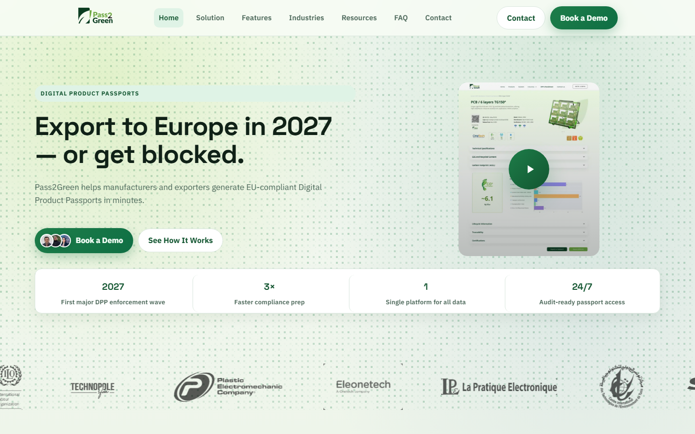
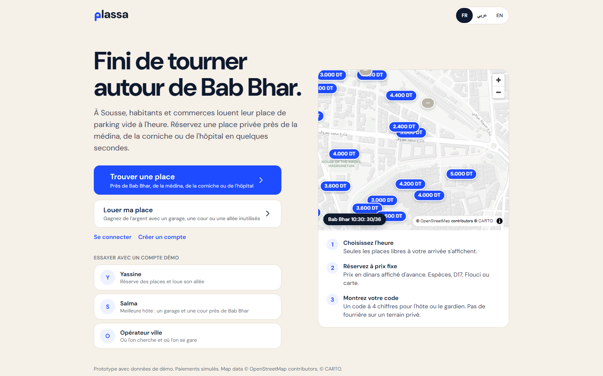
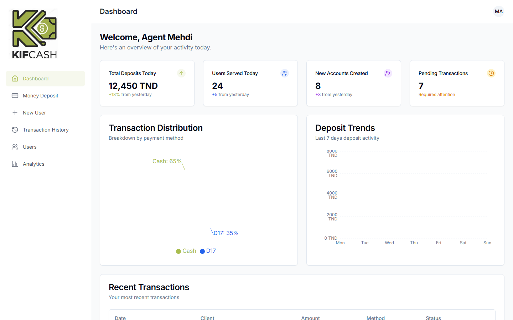
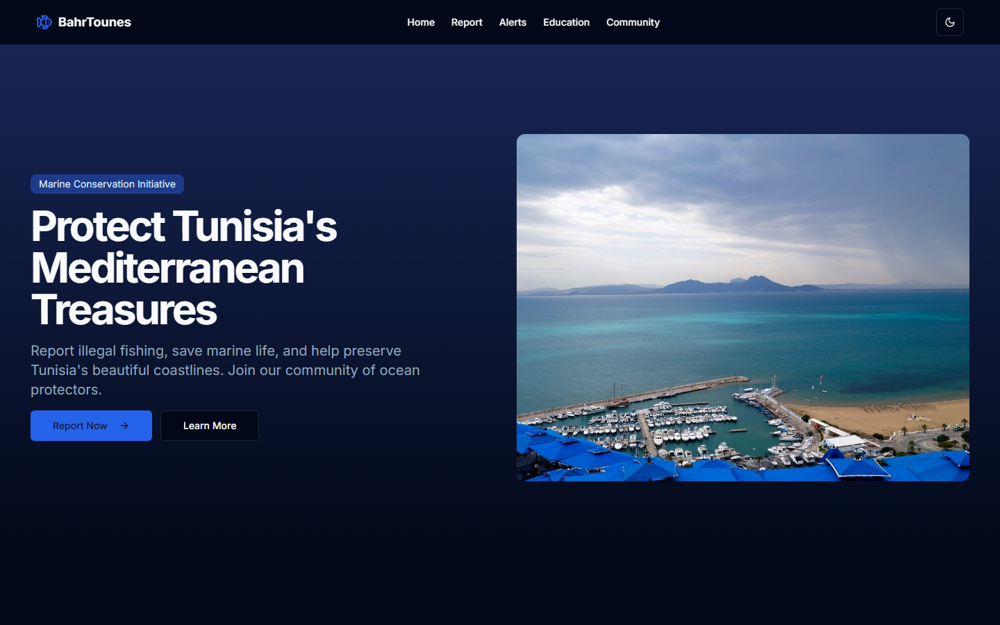

<a href="https://ahmedkahloun.vercel.app">
  <picture>
    <source media="(prefers-color-scheme: dark)" srcset="assets/banner-dark.svg">
    
  </picture>
</a>

Hey, I'm Ahmed. By day I'm the **Tech Lead at GoToGreen**, where we build **Pass2Green**: it helps manufacturers produce the Digital Product Passports the EU will soon require for anything sold in Europe. On a lot of weekends, I'm at a hackathon building something for a problem I bumped into that week.

[Portfolio](https://ahmedkahloun.vercel.app) &nbsp;·&nbsp; [LinkedIn](https://www.linkedin.com/in/ahmed-kahloun) &nbsp;·&nbsp; [Email](mailto:kahlounahmed1@gmail.com) &nbsp;·&nbsp; [CV](https://ahmedkahloun.vercel.app/ahmed-kahloun-cv.pdf)

---

### Things I've shipped

<table>
  <tr>
    <td width="50%" valign="top">
      <a href="https://pass2green-landing-page.vercel.app"></a>
      <br><b>Pass2Green</b> &nbsp;<sub>GoToGreen · I lead the tech</sub>
      <br>EU Digital Product Passports and an AI carbon-footprint calculator. Next.js, NestJS, MongoDB Atlas.
    </td>
    <td width="50%" valign="top">
      <a href="https://plassa.vercel.app"></a>
      <br><b><a href="https://github.com/ka7loun/plassa">Plassa</a></b> &nbsp;<sub>Hackathon prototype</sub>
      <br>Stop circling the block: rent a resident's empty parking spot by the hour.
    </td>
  </tr>
  <tr>
    <td width="50%" valign="top">
      <a href="https://kifcash-agent-dashboard.vercel.app"></a>
      <br><b><a href="https://github.com/ka7loun/kif-cash-dashboard-design">KifCash</a></b> &nbsp;<sub>1st place, BankiFi Hackathon 2025</sub>
      <br>Banking for people without a bank: agent networks, an AI advisor and USSD for phones without internet.
    </td>
    <td width="50%" valign="top">
      <a href="https://bahrtounes-essths-sdc.vercel.app"></a>
      <br><b><a href="https://github.com/ka7loun/BahrTounes">BahrTounes</a></b> &nbsp;<sub>Marine conservation</sub>
      <br>Spot illegal fishing, drop a pin, report it. Citizen reporting for marine conservation.
    </td>
  </tr>
</table>

Also: **[RNE](https://github.com/ka7loun/RNE)** (multilingual company-name validation for a national registry, Hack4Justice finalist) · **[Smart IT Support](https://github.com/ka7loun/smart-it-support-dashboard)** (a helpdesk that triages itself, built at LEONI) · **[TuniWaste](https://github.com/ka7loun/Tuniwaste)** (a marketplace for industrial waste) · **[Navigateur NIRD](https://github.com/ka7loun/navigateur-NIRD)** (a browser extension for a lighter web)

### The trophy shelf

```text
2025  1st place      BankiFi Hackathon ........ SAP University
2025  Finalist       Hack4Justice ............. RNE
2024  3rd place      Civic Spirit Hackathon ... MIT
2024  Leadership     Excellence Award ......... IEEE
      Best project   TechFest ................. IEEE
```

### What I work with

<a href="https://ahmedkahloun.vercel.app"></a>

### A few things about me

- I led IEEE's Computer Society at ESSTHS for two years: 10+ workshops, 30+ students coached for hackathons.
- I care about the boring parts too: CI on day one, role-based access done properly, a README people can actually follow.
- Ask me about **ESPR and Digital Product Passports**. I promise it's more interesting than it sounds.
- Studying Computer Science at ISITCOM, working remotely in UTC+1.
- Open to **remote roles and freelance projects**.

<sub>If you made it this far, say hi: <a href="mailto:kahlounahmed1@gmail.com">kahlounahmed1@gmail.com</a>. Remote roles, freelance work and hackathon invites all welcome.</sub>
